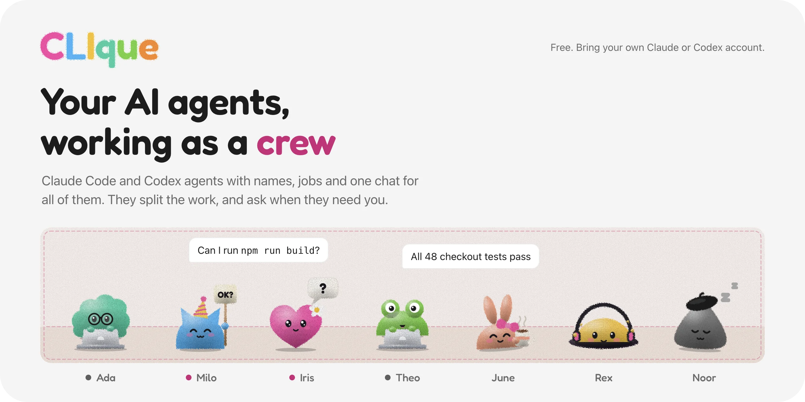
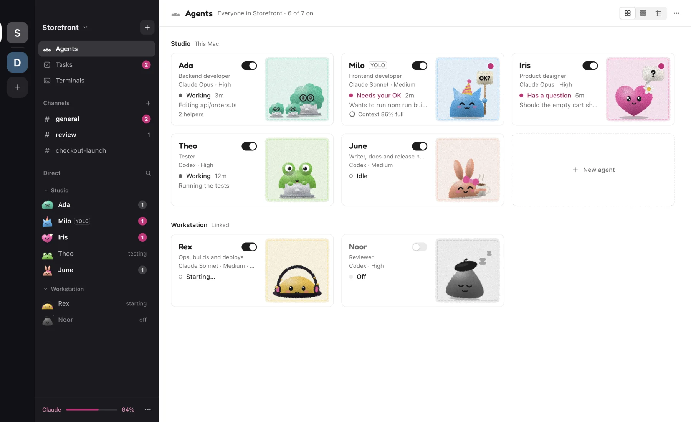
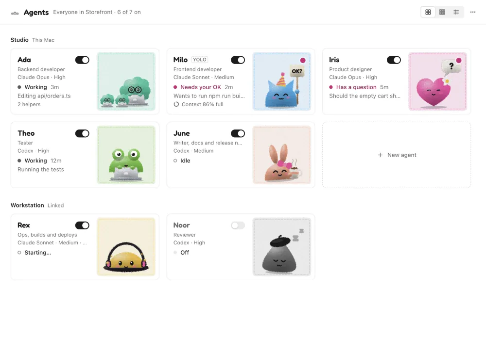
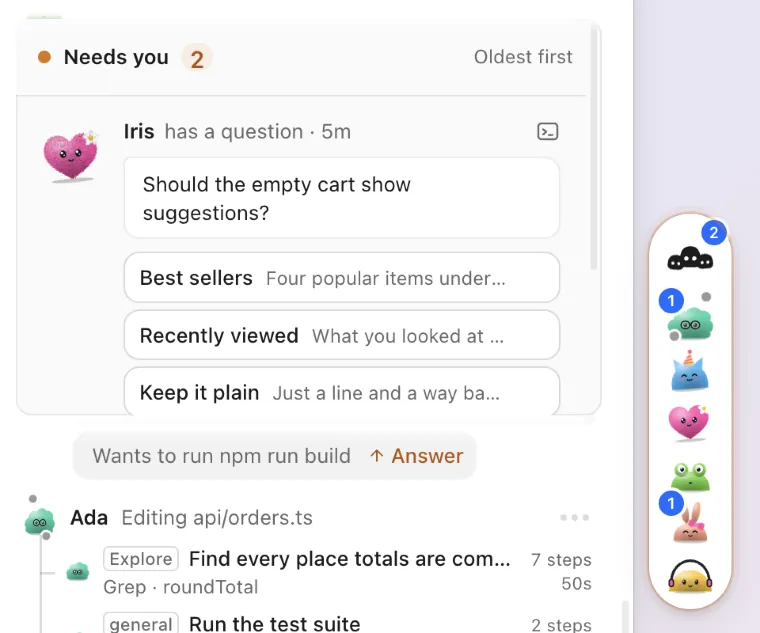
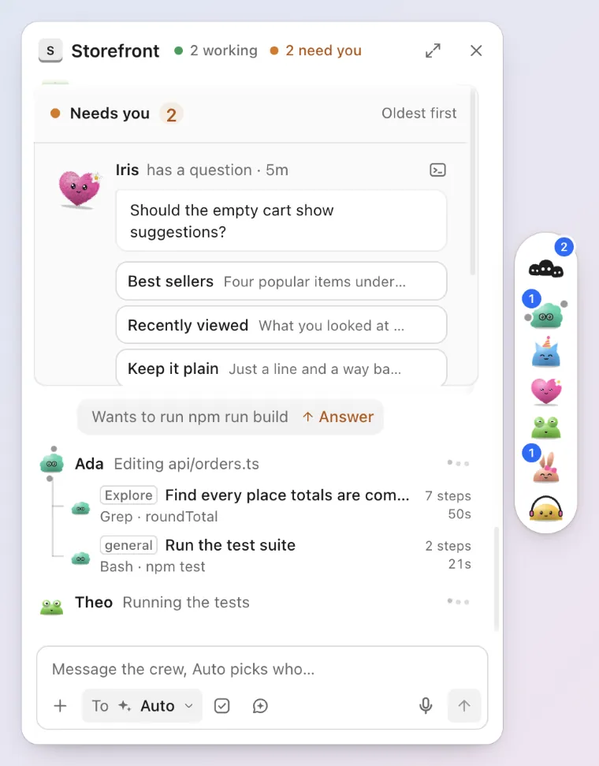
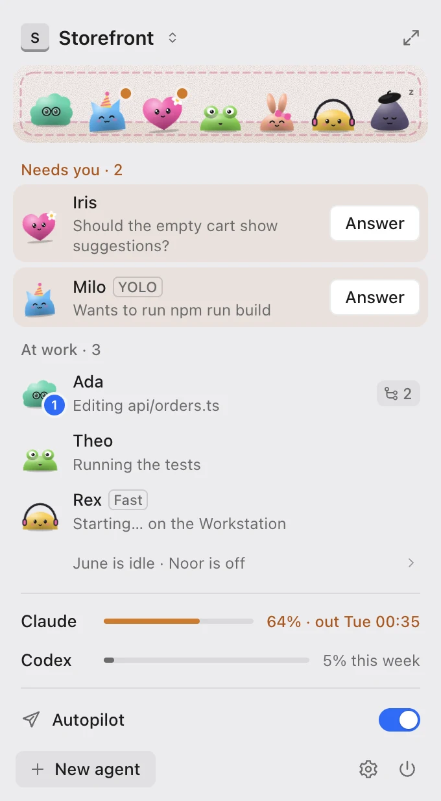
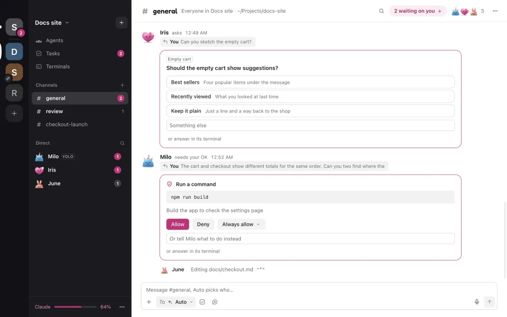

<p align="center">
  
</p>

<h3 align="center">Your AI coding agents, working as a clique.</h3>

<p align="center">
  CLIque runs a team of Claude Code and Codex agents side by side on your Mac or Windows PC.<br>
  You talk to all of them in one chat. They split the work, ask each other, and come to you only when it matters.
</p>

<picture>
  <source media="(prefers-color-scheme: dark)" srcset="docs/images/clique-dark.webp">
  
</picture>

## Why CLIque

- **A clique instead of one prompt.** Each agent has a name, a job, its own instructions and a felt creature for a face. Give work to whoever's free instead of waiting for one agent to finish.
- **One chat for everything.** `@mention` anyone, or let CLIque pick who fits. Permission prompts and questions come to you in the chat, in plain words.
- **They work together.** Agents hand off tasks, ask each other questions mid-task, and never edit the same file at once.
- **Nothing is lost.** Quit CLIque and your agents keep working. Open it again and they're right where they were.
- **Every computer, one clique.** Link your Macs and PCs, and keep an eye on everything from your phone.
- **It watches the bill.** Usage limits, what each task costs, and token savers that cut what the clique spends.

It runs Claude Code and Codex. GLM and local models (through Ollama) work too, and you can add other providers.

## Get started

You need a Mac (Apple silicon or Intel) or a Windows PC (Windows 10 or 11), with Claude Code or Codex installed and signed in. CLIque uses your own account and doesn't need one of its own.

1. **Install.** On a Mac, drag CLIque into Applications. On Windows, run the installer.
2. **Open it.** CLIque finds Claude Code and Codex, and tells you exactly what to install or sign in to if one is missing.
3. **Make your first workspace**: a name and the folder of what you're working on.
4. **Add your first agent**, give it a job, and start talking.

On Windows, Git for Windows is recommended: Claude Code runs its commands in Git Bash when it's there.

<details>
<summary><b>Run it from source</b></summary>

You also need Node.js.

```sh
npm install
npm start
```

On a Mac, the first `npm start` builds `CLIque.app` and opens it. `npm run dist` makes the installers, and `npm test` runs the tests.

</details>

## Meet your clique

Every agent gets a card: what it does, which model it runs on, and what it's busy with. Each creature acts it out. It types at a little laptop while it works, holds a mug while it's free, and holds up an "OK?" sign when it needs your permission. Switch one off and it falls asleep in black and white, ready to pick its conversation back up.

<p align="center"></p>

Click a card to set the agent's job, model and folder, and to write its instructions, or let it draft them for itself from its name and job.

<p align="center"></p>

## One chat, one conversation per agent


Everyone talks in **#general**. Write a message and CLIque gives it to the agent whose job fits and who's free, or type `@` and pick. Mention several agents and each gets one copy, knowing who else has it.

Click an agent to open your conversation with it, with its terminal beside the chat. Make **channels** for parts of the work, each with its own members and a short brief.

When an agent needs a decision ("Can I run `npm run build`?"), it asks at the top of the chat and you answer there, no terminal needed. Busy agents get your message the moment they're free. Or hold the mic and just talk: dictation runs on your computer, so your voice never leaves it.

<br clear="right">

## Tasks

Unrelated work piling up in one conversation confuses agents. On the Tasks board, every task gets a fresh conversation. Add a bug or a feature, assign it (or let a triage agent pick), and press Start. Finished work lands in Review: accept it, or send it back with a note.

<p align="center"></p>

## Watch them work

<picture>
  <source media="(prefers-color-scheme: dark)" srcset="docs/images/terminals-dark.webp">
  
</picture>

Every agent has its own terminal. See them all side by side, or open one and type into it.

<table>
<tr>
<td width="50%" valign="top">
<b>Sub-agents.</b> When a Claude Code agent splits a job, the chat shows each sub-agent and the step it's on.
<br><br>

</td>
<td width="50%" valign="top">
<b>Clones.</b> Give an agent clones and it stops making you wait. While it's busy, a copy of it takes the next task.
<br><br>

</td>
</tr>
</table>

## Always within reach

<p align="center">
  <picture>
    <source media="(prefers-color-scheme: dark)" srcset="docs/images/chat-dark.webp">
    
  </picture>
  &nbsp;
  <picture>
    <source media="(prefers-color-scheme: dark)" srcset="docs/images/tray-dark.webp">
    
  </picture>
</p>

- **The pill** sits on the edge of your screen with the clique inside, hopping while they work. Click it or press `⌥⇧Space` (Alt+Shift+Space on Windows) to open the chat from any app.
- **The menu bar** (the taskbar on Windows) shows who's working and who needs you, with a switch for each agent.
- **Your phone.** Pair the CLIque phone app with a QR code to chat and answer your agents' questions away from your desk, encrypted end to end.

## A clique per project

<picture>
  <source media="(prefers-color-scheme: dark)" srcset="docs/images/workspaces-dark.webp">
  
</picture>

Give each project a workspace: its folder, the agents who work on it, and its own chat, channels and tasks. Your agents are the same everywhere; pick who works where. Every workspace runs at once, and an orange count tells you when another one needs you. Jump between them with `⌃1`–`⌃9`, and put one to sleep when you're not on it.

<p align="center"></p>

## All your computers, one clique

<picture>
  <source media="(prefers-color-scheme: dark)" srcset="docs/images/computers-dark.webp">
  
</picture>

Open **Computers** on two of your machines and they find each other. Click **Link**, check the code is the same on both screens, and each one's workspaces show up on the other. Add agents from both to a workspace and they work as one clique. Chat with any of them and watch its terminal from either side. Drag an agent to another computer and its conversation goes with it.

A workspace belongs to the computer that made it. It shows up on your other computers on its own, and they can add agents of their own. Two workspaces with the same name on different computers stay separate.

## Spend less

- **Usage limits** for your Claude and Codex accounts, with the pace they're heading at and a heads-up before you run out.
- **What it costs**, per agent and per task.
- **Token savers**: six switches that cut what a clique spends, such as starting fresh after a long break and showing agents only the notes they haven't read. Each one measures what it saved.

## How agents talk to each other

Agents pass work around with a small `clique` command:

```sh
clique ask ada "which port is staging on?"     # ask a teammate and wait for the answer
clique answer "4000"                           # answer one, even in the middle of a task
clique send milo "fix the coupon field"        # hand work to a teammate for good
clique note "API runs on port 4000"            # tell the whole clique something
clique post ship "1.2 is out"                  # say something in the channel it picks
clique who                                     # see who's around
clique task list                               # pick up work from the Tasks board
```

A question reaches a teammate even mid-task, so the answer comes back in seconds. CLIque also decides who goes first when agents need each other, so they never wait on each other in circles, and the chat says so in one quiet line.

<p align="center"></p>

Prefer to approve every hand-off? Turn Autopilot off.

## Share agents

Export one agent or a few as a `.clique` file and send it to a friend. They get the names, jobs, instructions and looks. Your folders and history stay with you.

## More

- **[The full guide](docs/guide.md)** covers every setting, the files CLIque keeps in `~/.clique`, and how it works inside.
- **The code:** the desktop app is in `desktop/`, the phone app in `mobile/`, and the protocol they share in `shared/`.
- **The pictures:** `npm run shots` renders every screen with a made-up clique.
