<p align="center">
  <picture>
    <source media="(prefers-color-scheme: dark)" srcset="docs/images/cover-dark.webp">
    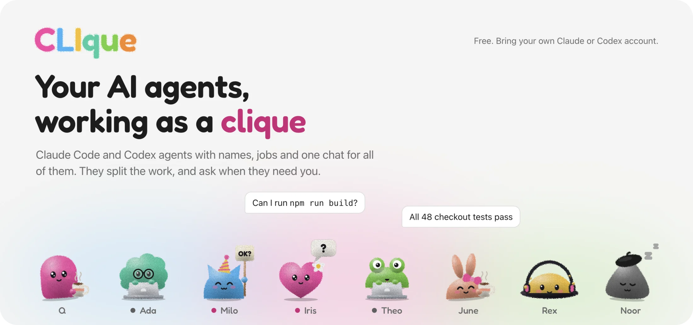
  </picture>
</p>

<p align="center">
  <b>CLIque runs a team of Claude Code and Codex agents side by side on your Mac or PC.</b><br>
  You talk to all of them in one chat. They split the work, ask each other, and come to you only when it matters.
</p>

<p align="center">
  <a href="#get-clique"><b>Get CLIque</b></a> ·
  <a href="#the-tour">The tour</a> ·
  <a href="#how-agents-talk-to-each-other">How agents talk</a> ·
  <a href="#it-all-stays-with-you">What stays with you</a> ·
  <a href="docs/guide.md">The full guide</a>
</p>

<p align="center">
  <kbd>Mac</kbd> <kbd>Windows</kbd> <kbd>iPhone</kbd> <kbd>Android</kbd>
</p>

<picture>
  <source media="(prefers-color-scheme: dark)" srcset="docs/images/hero-dark.webp">
  
</picture>

## What you get

- **A clique instead of one prompt.** Each agent has a name, a job, its own instructions and a felt creature for a face. Give work to whoever's free instead of waiting for one agent to finish.
- **One chat for everything.** Say what you need and Q, the agent every workspace comes with, gets it to whoever should do it. Or `@mention` anyone yourself.
- **Questions in plain words.** "Can I run `npm run build`?" comes to you in the chat, with Allow and Deny. There's no terminal to keep an eye on.
- **They work together.** Agents hand off tasks, ask each other questions mid-task, and never edit the same file at once.
- **Nothing is lost.** Quit CLIque and your agents keep working. Open it again and they're right where they were.
- **Every computer, one clique.** Link your Macs and PCs, and answer your agents from your phone.
- **It watches the bill.** Usage limits, what each task costs, and token savers that cut what the clique spends.

It runs Claude Code and Codex. GLM and local models (through Ollama) work too, and you can add other providers.

## The tour

### Meet your clique

Every agent gets a card: what it does, which model it runs on, and what it's busy with. Each creature acts it out. It types at a little laptop while it works, holds a mug while it's free, and holds up an "OK?" sign when it needs your permission. Switch one off and it falls asleep in black and white, ready to pick its conversation back up.

<picture>
  <source media="(prefers-color-scheme: dark)" srcset="docs/images/agents-dark.webp">
  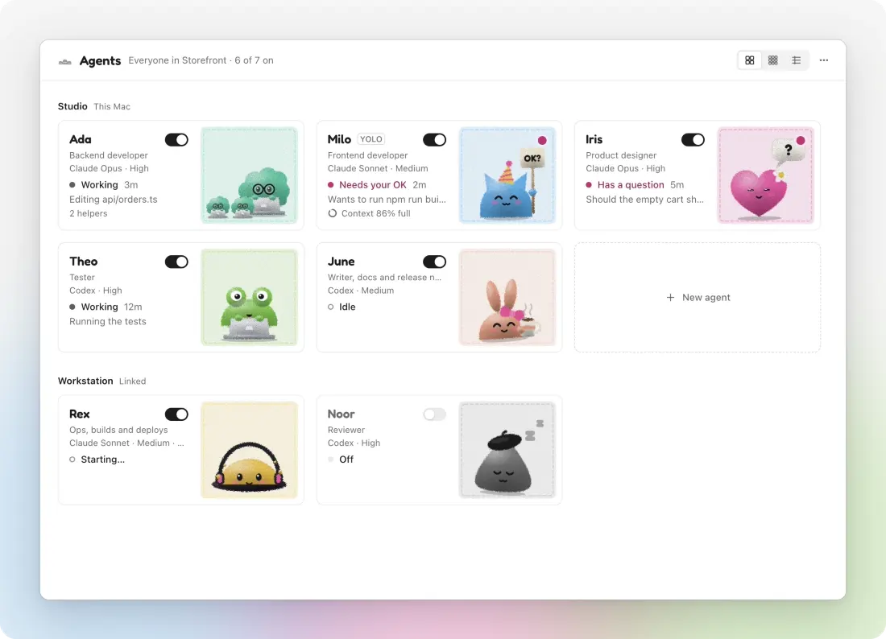
</picture>

Click a card to set the agent's job, model and folder, and to write its instructions, or let it draft them for itself from its name and job. An agent with nothing to do rests: its terminal stops after ten minutes, and starts again the moment there's work for it.

### One chat, and a conversation with each agent

Everyone talks in **#general**. When an agent needs a decision, it asks right there and you answer right there, no terminal needed. Click an agent to open your conversation with it, with its terminal beside the chat. Make **channels** for parts of the work, each with its own members and a short brief.

<picture>
  <source media="(prefers-color-scheme: dark)" srcset="docs/images/chat-dark.webp">
  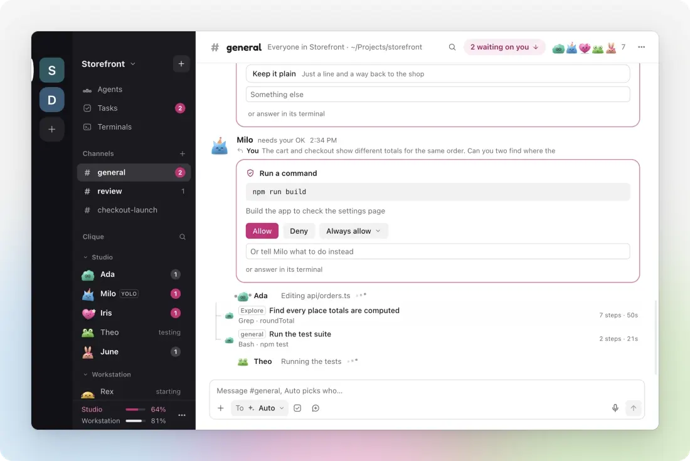
</picture>

Busy agents get your message the moment they're free. Type `@` to pick who gets it, paste a screenshot, drop a folder, or hold the mic and just talk: dictation runs on your computer, so your voice never leaves it.

### Q gets it to the right agent

Every workspace comes with **Q**, the queue in CLIque. What you send without naming anyone goes to him. He answers it or hands it to whoever should do it, and tells you how it went. Naming someone is still a direct line to them, and with Q switched off CLIque picks by each agent's job.

<picture>
  <source media="(prefers-color-scheme: dark)" srcset="docs/images/q-dark.webp">
  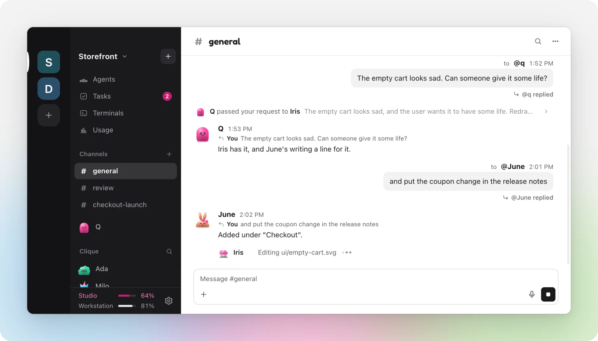
</picture>

### Threads, and pictures when words won't do

<table>
<tr>
<td width="50%" valign="top">
<picture>
  <source media="(prefers-color-scheme: dark)" srcset="docs/images/threads-dark.webp">
  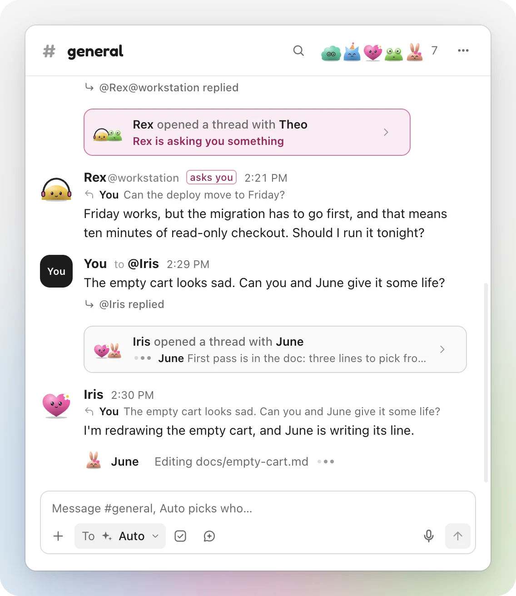
</picture>
<br>
<sub><b>Threads.</b> What agents say to each other folds into one card under the request that started it. Open it when you're curious.</sub>
</td>
<td width="50%" valign="top">
<picture>
  <source media="(prefers-color-scheme: dark)" srcset="docs/images/canvas-dark.webp">
  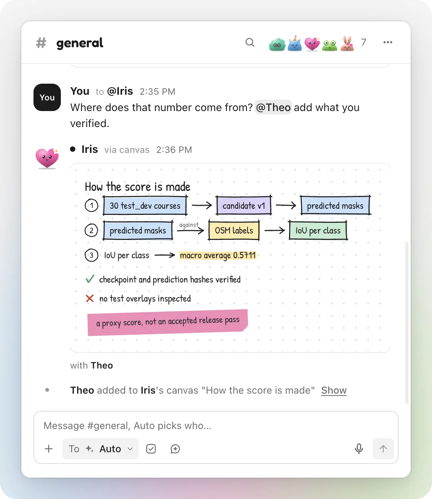
</picture>
<br>
<sub><b>Canvases.</b> An agent can draw its answer instead of writing it out: boxes, arrows, bars, a sticky note. A teammate can add to it.</sub>
</td>
</tr>
</table>

### Tasks

Unrelated work piling up in one conversation confuses agents. On the Tasks board, every task gets a fresh conversation. Add a bug or a feature, assign it (or let a triage agent pick), and press Start. Finished work lands in Review: accept it, or send it back with a note.

<picture>
  <source media="(prefers-color-scheme: dark)" srcset="docs/images/tasks-dark.webp">
  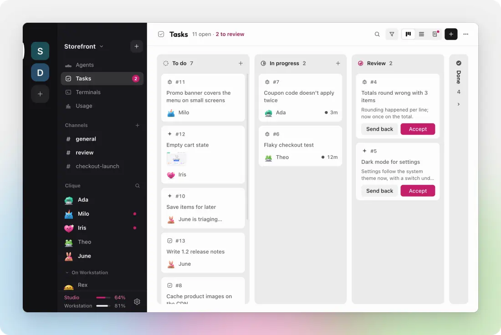
</picture>

### Watch them work

Every agent has its own terminal. See them all side by side, or open one and type into it.

<picture>
  <source media="(prefers-color-scheme: dark)" srcset="docs/images/terminals-dark.webp">
  
</picture>

- **Sub-agents.** When a Claude Code agent splits a job, the chat shows each sub-agent and the step it's on.
- **Clones.** Give an agent clones and it stops making you wait. While it's busy, a copy of it takes the next task.

### Always within reach

<table>
<tr>
<td width="50%" valign="top">
<picture>
  <source media="(prefers-color-scheme: dark)" srcset="docs/images/floating-dark.webp">
  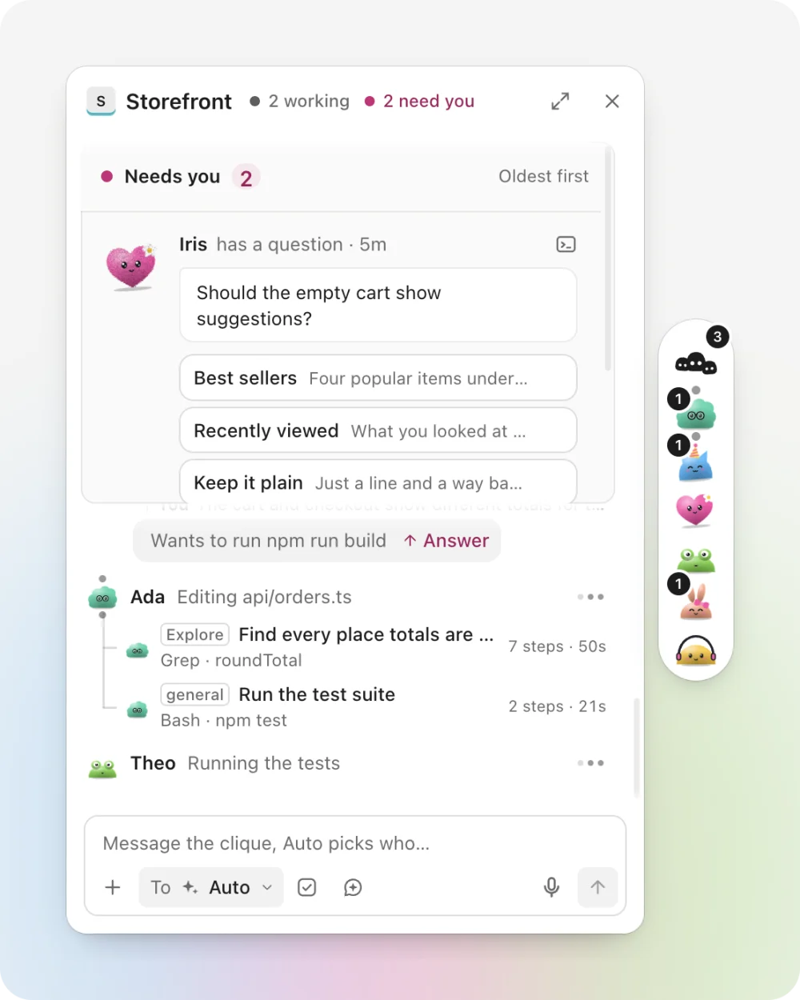
</picture>
<br>
<sub><b>The pill</b> sits on the edge of your screen with the clique inside. Click it, or press <kbd>⌥</kbd><kbd>⇧</kbd><kbd>Space</kbd>, for the chat from any app.</sub>
</td>
<td width="50%" valign="top">
<picture>
  <source media="(prefers-color-scheme: dark)" srcset="docs/images/hatch-dark.webp">
  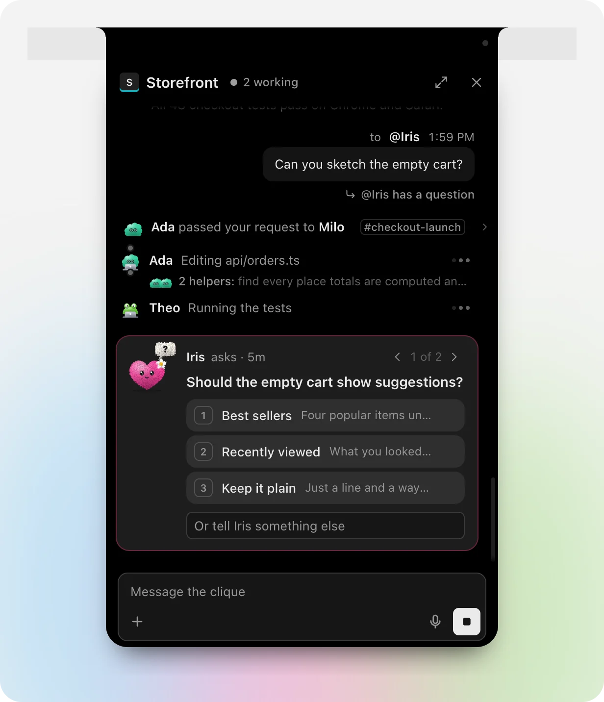
</picture>
<br>
<sub><b>The notch.</b> Drag the pill to the top of a MacBook's screen and it moves into the notch. The chat drops out of it.</sub>
</td>
</tr>
</table>

The menu bar (the taskbar on Windows) shows who's working and who needs you, with a switch for each agent.

**And your phone.** Pair the CLIque app with a QR code to chat with the clique and answer its questions away from your desk. It talks straight to your computer, encrypted end to end.

<p align="center">
  <picture>
    <source media="(prefers-color-scheme: dark)" srcset="docs/images/phone-dark.webp">
    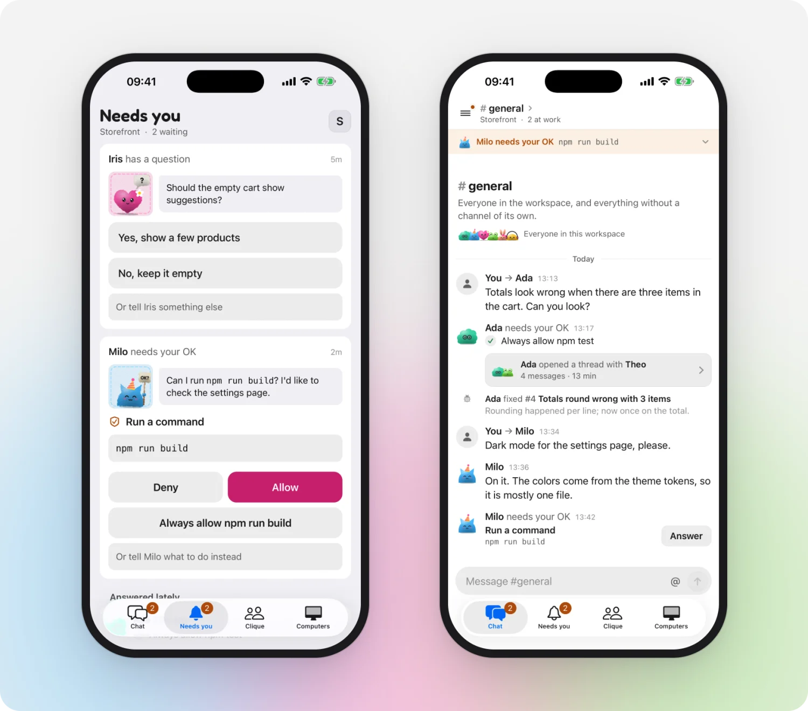
  </picture>
</p>

### A clique per project

Give each project a workspace: its folder, the agents who work on it, and its own chat, channels and tasks. Your agents are the same everywhere; pick who works where. Every workspace runs at once, and a count tells you when another one needs you. Jump between them with <kbd>⌃</kbd><kbd>1</kbd> to <kbd>⌃</kbd><kbd>9</kbd>, and put one to sleep when you're not on it.

<p align="center">
  <picture>
    <source media="(prefers-color-scheme: dark)" srcset="docs/images/workspaces-dark.webp">
    
  </picture>
</p>

### All your computers, one clique

Open **Computers** on two of your machines and they find each other. Click **Link**, check the code is the same on both screens, and each one's workspaces show up on the other. Add agents from both to a workspace and they work as one clique. Chat with any of them and watch its terminal from either side. Drag an agent to another computer and its conversation goes with it.

<p align="center">
  <picture>
    <source media="(prefers-color-scheme: dark)" srcset="docs/images/computers-dark.webp">
    
  </picture>
</p>

### Spend less

- **Usage limits** for your Claude and Codex accounts on every computer, with the pace they're heading at and a heads-up before you run out.
- **Usage**, by the things you work with: the workspace you're in or everything, on this computer, a linked one or all of them added up. Tokens over time split by workspace, agent, provider or computer, a calendar of days for each provider, and who used it, where and on which models. Click any row to see only that. It's read from Claude Code's and Codex's own logs on each computer, so it covers what you ran outside CLIque too.
- **What it costs**, per agent and per task.
- **Token savers**: six switches that cut what a clique spends, such as starting fresh after a long break and showing agents only the notes they haven't read. Each one measures what it saved.

<picture>
  <source media="(prefers-color-scheme: dark)" srcset="docs/images/usage-dark.webp">
  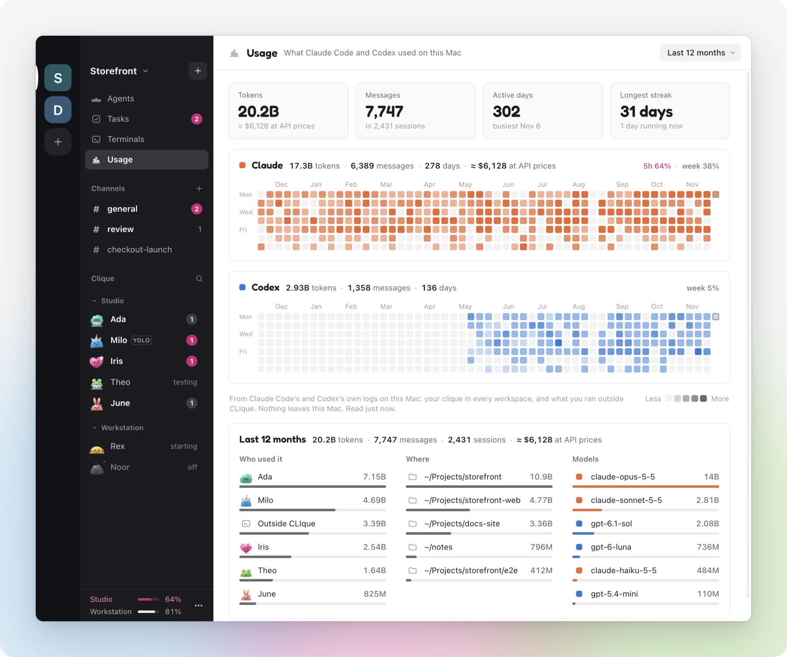
</picture>

## How agents talk to each other

Agents pass work around with a small `clique` command:

```sh
clique ask ada "which port is staging on?"     # ask a teammate and wait for the answer
clique answer "4000"                           # answer one, even in the middle of a task
clique send milo "fix the coupon field"        # hand work to a teammate for good
clique note "API runs on port 4000"            # tell the whole clique something
clique post ship "1.2 is out"                  # say something in the channel it picks
clique canvas new '[cart] -> [payment]'        # draw it in the chat instead of writing it out
clique who                                     # see who's around
clique task list                               # pick up work from the Tasks board
```

A question reaches a teammate even mid-task, so the answer comes back in seconds. CLIque also decides who goes first when agents need each other, so they never wait on each other in circles, and the chat says so in one quiet line.

<p align="center">
  <picture>
    <source media="(prefers-color-scheme: dark)" srcset="docs/images/right-of-way-dark.webp">
    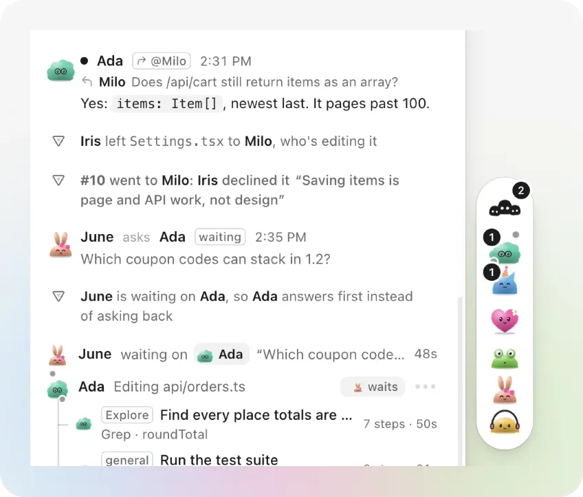
  </picture>
</p>

Prefer to approve every hand-off? Turn Autopilot off. And you can ask an agent to change CLIque itself ("add a #design channel for Iris and June"): it asks first, like any other permission.

## It all stays with you

- **Your account.** CLIque runs the Claude Code and Codex you already installed, signed in as you. It has no account of its own and sells you no tokens.
- **Your computers.** Agents run in terminals on your machine. CLIque has no servers.
- **Your network.** Linked computers and your phone talk straight to each other, encrypted, over your Wi-Fi or Tailscale.
- **Your files.** Everything CLIque keeps is in `~/.clique`, in files you can read.

## Get CLIque

You need a Mac (Apple silicon or Intel) or a Windows PC (Windows 10 or 11), with Claude Code or Codex installed and signed in.

1. **Install.** On a Mac, drag CLIque into Applications. On Windows, run the installer.
2. **Open it.** CLIque finds Claude Code and Codex, and tells you exactly what to install or sign in to if one is missing.
3. **Say what you're working on.** Q asks what kind of work it is, makes your first workspace and suggests a clique for it.
4. **Start talking.**

On Windows, Git for Windows is recommended: Claude Code runs its commands in Git Bash when it's there.

### From this repo

You also need Node.js.

```sh
npm install
npm start        # on a Mac, the first one builds CLIque.app and opens it
npm test
npm run dist     # what people install, for the system you're on
```

The phone app is in [`mobile/`](mobile/README.md), and [`site/README.md`](site/README.md) covers the website and where releases go.

<details>
<summary><b>Keyboard shortcuts</b></summary>
<br>

On Windows, ⌘ is Ctrl, and ⌥ and ⌃ are Alt.

| Keys | What it does |
|---|---|
| <kbd>⌥</kbd><kbd>⇧</kbd><kbd>Space</kbd> | Open the floating chat from any app |
| <kbd>⌥</kbd><kbd>⇧</kbd><kbd>D</kbd> | Open the chat and start dictating |
| <kbd>⌘</kbd><kbd>F</kbd> | Find an agent by name or job |
| <kbd>⌘</kbd><kbd>N</kbd> | New agent |
| <kbd>⌃</kbd><kbd>1</kbd> to <kbd>⌃</kbd><kbd>9</kbd> | Jump to a workspace |
| <kbd>⌃</kbd><kbd>Tab</kbd> | The next workspace |

</details>

## More

- **[The full guide](docs/guide.md)** covers every setting, the files CLIque keeps in `~/.clique`, and how it works inside.
- **Share agents.** Export one agent or a few as a `.clique` file and send it to a friend. They get the names, jobs, instructions and looks. Your folders and history stay with you.
- **The code:** the desktop app is in `desktop/`, the phone app in `mobile/`, and the protocol they share in [`shared/`](shared/PROTOCOL.md).
- **The pictures:** `npm run readme` takes every picture on this page again from the app as it is, with a made-up clique.

<p align="center"><sub>© 2026 Green Grass Inc. · <a href="LICENSE">License</a></sub></p>
