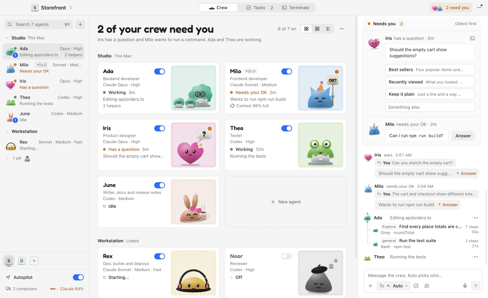
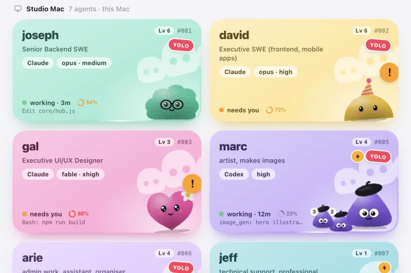
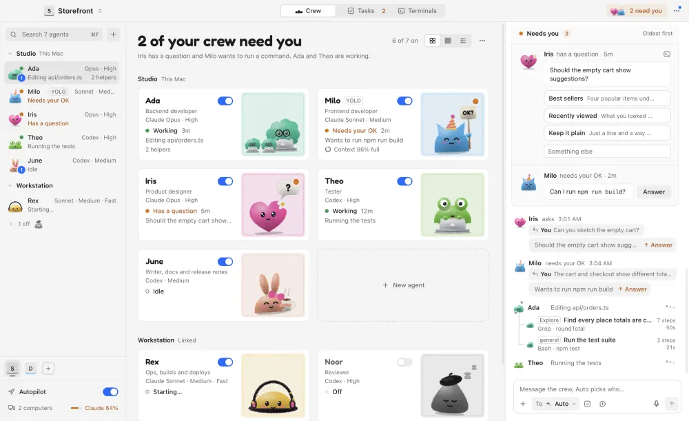
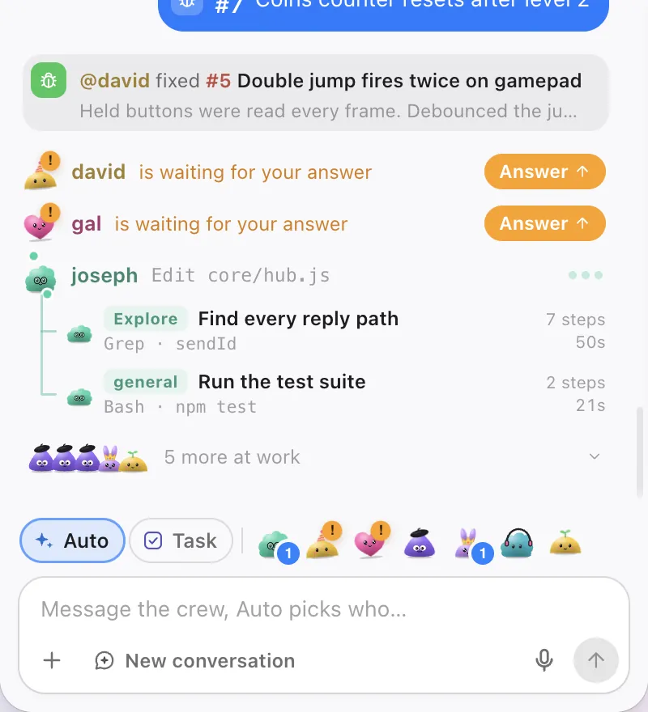
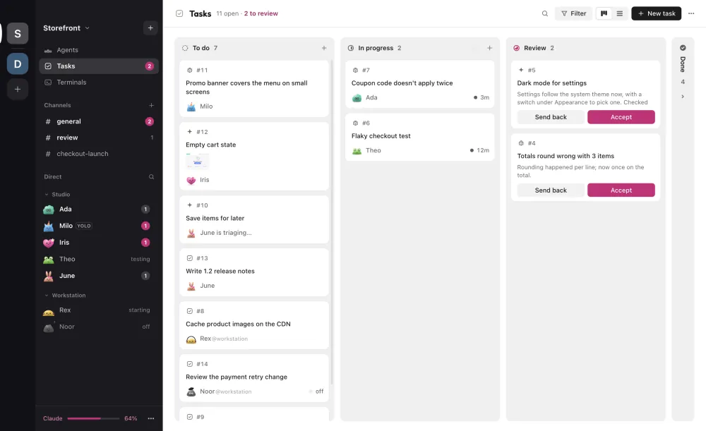
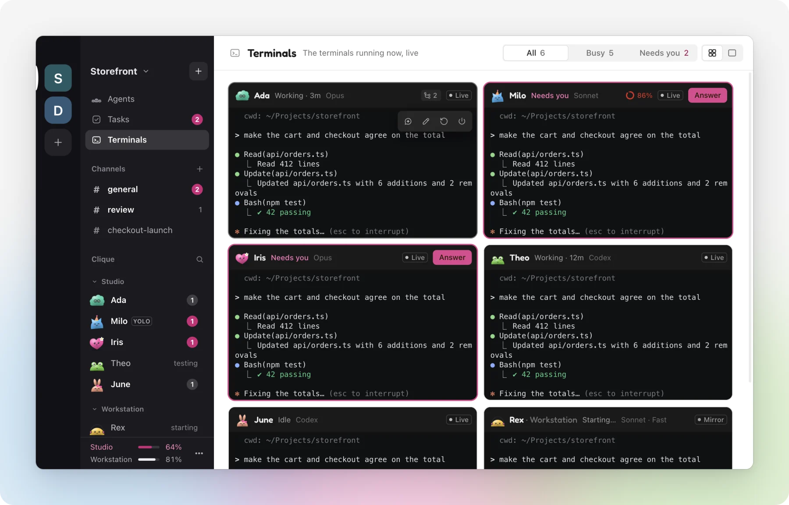
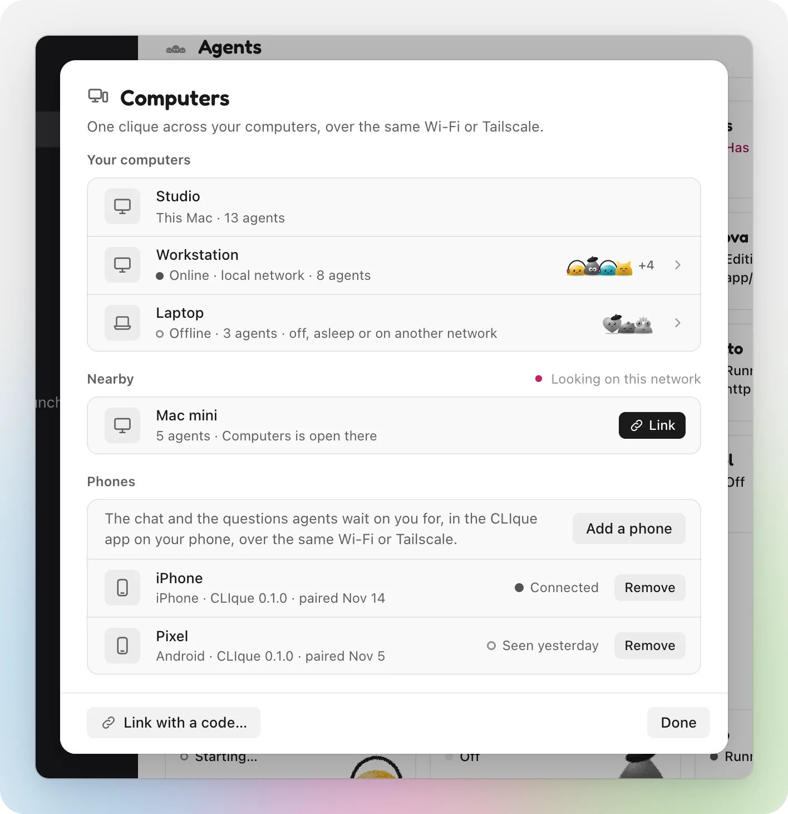
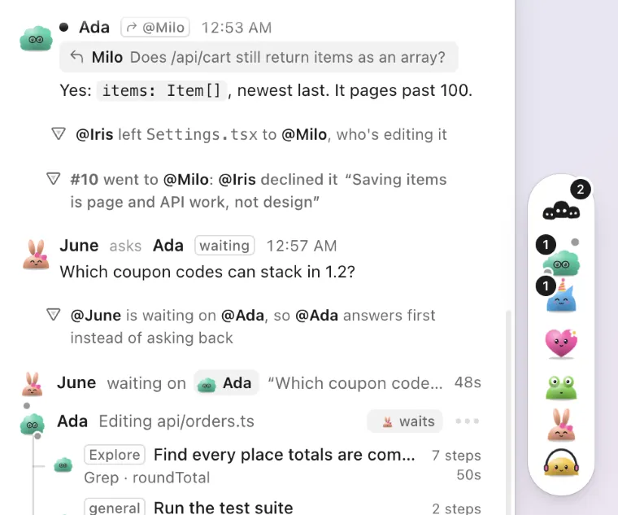

<p align="center">
  
</p>

Crew is a Mac app for running a team of AI coding agents. Each agent gets a name, a job, its own instructions and a small felt creature for a face. You talk to all of them in one chat. They hand work to each other, and when one of them needs a decision, it asks you.

It runs Claude Code and Codex. GLM and local models (through Ollama) work too, and you can add other providers.

<picture>
  <source media="(prefers-color-scheme: dark)" srcset="docs/images/crew-dark.webp">
  
</picture>

## Get started

You need macOS, Node.js, and Claude Code or Codex installed and signed in.

```sh
npm install
npm start
```

The first `npm start` builds `Crew.app` and opens it. After that it opens right away. Drag `dist/Crew.app` to your Dock to keep it handy.

Quitting Crew doesn't stop your agents: they keep working, and the next time you open Crew they're right where they were.

## Meet your crew

Agents show up as cards. A card shows what the agent does, which model it runs on, what it's busy with and how full its conversation is. Point at a card and it tilts like a holo trading card.

<p align="center"></p>

Click a card to open it. This is where you set the agent's job, model and folder, and write its instructions (or let it draft them for itself). You can also dress it up.

<p align="center"></p>

## One chat for everyone



Write a message and Crew gives it to the agent whose job fits and who's free. Or type `@` and pick who it's for. Mention a few agents and each one gets its own copy.

Click an agent's face and the chat turns into your conversation with it. You see just what the two of you said, and everything you send goes to that agent. **All**, or clicking the agent again, takes you back to everyone.

If an agent is busy, your message waits and goes in the moment it's done.

When an agent wants permission or has a question, it shows up as a card in the chat. You answer there, no terminal needed.

You can also hold the mic and talk. Dictation runs on your Mac, so your voice never leaves it.

<br clear="right">

## Tasks

Agents get confused when one conversation piles up unrelated work. So on the Tasks board, every task starts a fresh conversation.

Add a bug or a feature, give it to someone (or let a triage agent pick), and press Start. Finished work lands in Review. Accept it, or send it back with a note.

<p align="center"></p>

## Watch them work

<picture>
  <source media="(prefers-color-scheme: dark)" srcset="docs/images/terminals-dark.webp">
  
</picture>

Every agent has its own terminal. Watch them all side by side, or open one and type into it.

<table>
<tr>
<td width="50%" valign="top">
When a Claude Code agent splits a job between sub-agents, the chat shows each one and the step it's on.
<br><br>

</td>
<td width="50%" valign="top">
Give an agent clones and it stops making you wait. While it's busy, a copy of it takes the next task.
<br><br>

</td>
</tr>
</table>

## The pill and the menu bar

<p align="center">
  <picture>
    <source media="(prefers-color-scheme: dark)" srcset="docs/images/chat-dark.webp">
    
  </picture>
  &nbsp;
  <picture>
    <source media="(prefers-color-scheme: dark)" srcset="docs/images/tray-dark.webp">
    
  </picture>
</p>

A little pill sits on the edge of your screen with the crew inside. They hop while they work. Click it, or press `⌥⇧Space`, and the chat opens. Drag the pill anywhere; near the top or bottom of the screen it lies flat, like the Dock.

The menu bar has the crew too. Hover an agent to switch it on or off, or to let it skip permission prompts (YOLO).

## A crew per project

<picture>
  <source media="(prefers-color-scheme: dark)" srcset="docs/images/workspaces-dark.webp">
  
</picture>

Give each project a workspace: a folder, the agents who work on it, and its own chat, notes and tasks. Your agents are the same everywhere, so pick who works where and they start in that project's folder. Every workspace runs at once; switch with the switcher, the dock at the foot of the sidebar or `⌃1`–`⌃9`, and an orange count says when another one needs you. Park a project you're not on: its agents stop, and pick up where they left off when you open it again.

<p align="center"></p>

## All your Macs, one crew

<picture>
  <source media="(prefers-color-scheme: dark)" srcset="docs/images/computers-dark.webp">
  
</picture>

Link your Macs with a pairing code and each one sees the whole crew. Chat with any agent and watch its terminal from either side. You can move an agent to another Mac, and its conversation goes with it. Workspaces work across Macs too: give a project's workspace the same name on each one, and it's one crew.

## Share agents

Export one agent or a few as a `.crew` file and send it to someone. They get the names, jobs, instructions and looks. Your folders and history stay with you.

## How agents talk to each other

Agents pass work around with a small `crew` command:

```sh
crew ask joseph "which port is staging on?"  # ask a teammate and wait for the answer
crew answer "4000"                           # answer one, even in the middle of a task
crew send david "fix the payload"            # hand work to a teammate for good
crew note "API runs on port 4000"            # tell the whole crew something
crew who                                     # see who's around
crew task list                               # pick up work from the Tasks board
```

A question reaches a teammate even when it's busy with something else. It shows up at the teammate's next step, the teammate answers and carries on, and the asker has the answer within seconds instead of waiting for the teammate to finish.

Crew also decides who goes first when agents need each other, so they never end up waiting in circles. An agent that's being waited on can't wait on its waiter, work can't be handed back to an agent that's waiting for your answer, and two agents never edit the same file at once. When Crew steps in, the chat says so in one quiet line.

<p align="center"></p>

Hand-offs show up in the chat with the sender's face next to them. Turn Autopilot off if you'd rather approve each one.

## More

- [The full guide](docs/guide.md) covers every setting, the files Crew keeps in `~/.crew`, and how it works inside.
- `npm run shots` renders every screen with a made-up crew. That's where these pictures come from.
