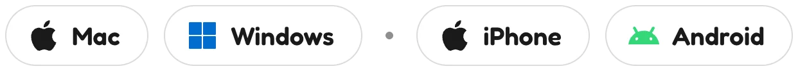
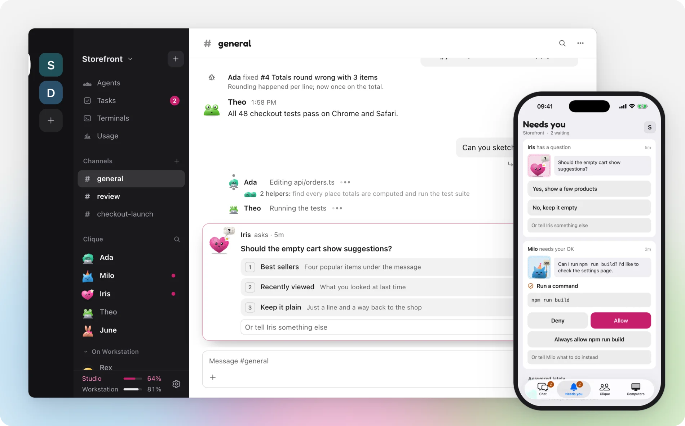
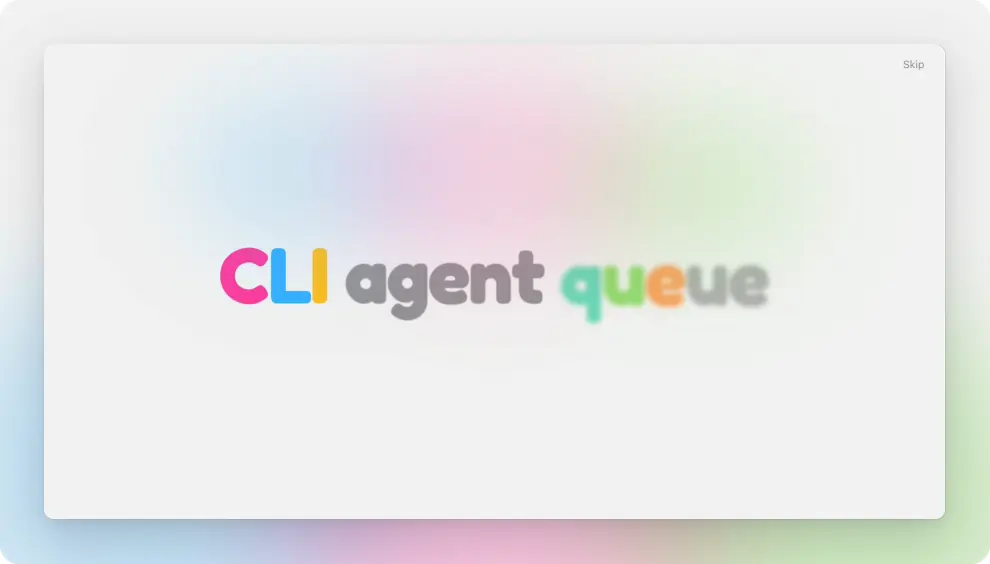
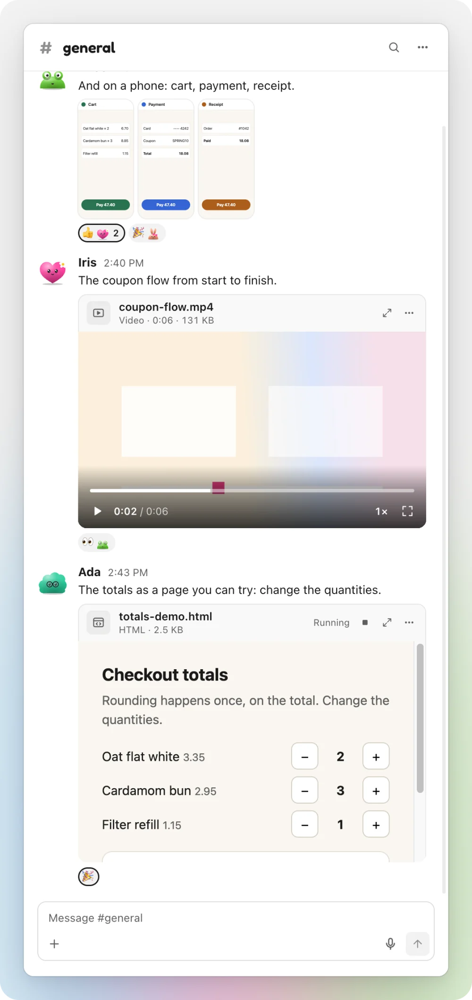
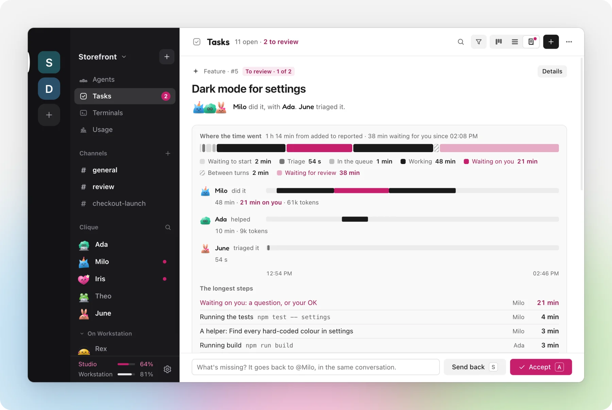
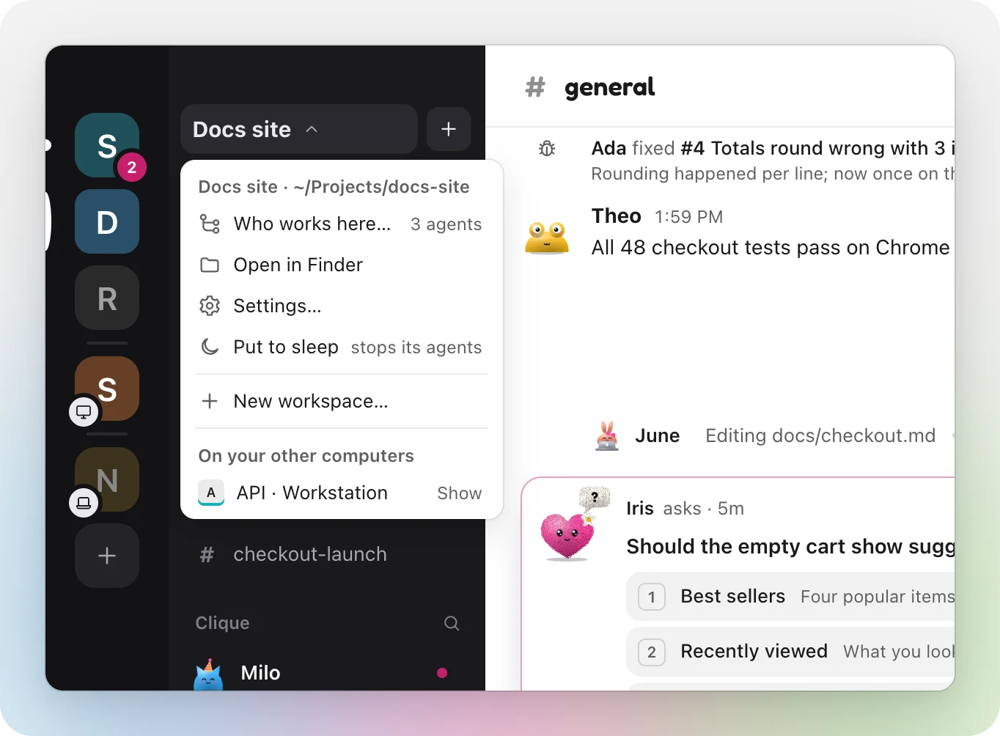

<p align="center">
  <picture>
    <source media="(prefers-color-scheme: dark)" srcset="docs/images/cover-dark.webp">
    
  </picture>
</p>

<h3 align="center">A team of Claude Code and Codex agents you run from one chat,<br>on every computer you own, and on your phone.</h3>

<p align="center">
  <a href="#get-clique">
    <picture>
      <source media="(prefers-color-scheme: dark)" srcset="docs/images/platforms-dark.webp">
      
    </picture>
  </a>
</p>

<p align="center">
  <a href="#get-clique"><b>Get CLIque</b></a> ·
  <a href="#meet-q">Meet Q</a> ·
  <a href="#the-tour">The tour</a> ·
  <a href="docs/guide.md">The guide</a>
</p>

<picture>
  <source media="(prefers-color-scheme: dark)" srcset="docs/images/hero-dark.webp">
  
</picture>

## Why CLIque

<table>
<tr>
<td width="50%" valign="top"><b>Start anywhere, finish anywhere.</b><br>Start on your Mac, pick it up on your PC, answer from your phone. One clique across all of them.</td>
<td width="50%" valign="top"><b>What matters, not walls of terminal.</b><br>Agents ask in plain words, in the chat. You answer with a tap.</td>
</tr>
<tr>
<td valign="top"><b>A workspace per project.</b><br>Its folder, its agents, its chat and its tasks. Every one runs at once.</td>
<td valign="top"><b>Fewer tokens, no surprises.</b><br>What every task took and where its time went, your limits before you hit them, and savers that cut the bill.</td>
</tr>
</table>

Free. It runs the Claude Code and Codex you already have, signed in as you. GLM and local models (through Ollama) work too.

## Meet Q

Every workspace comes with **Q**, the queue in CLIque. Tell him what you need: he hands it to whoever should do it, and tells you how it went.

The first time you open CLIque, he sets you up. He asks what kind of work it is and where it lives, and brings a clique for it.

<picture>
  <source media="(prefers-color-scheme: dark)" srcset="docs/images/first-run-dark.webp">
  
</picture>

## The tour

### One chat for everyone

Say it in **#general** and Q passes it on, or `@mention` someone yourself. When an agent needs a decision or your OK, it asks right there. Click an agent for your own conversation with it. Its terminal stays out of the way until you want to watch it work.

Paste a screenshot, drop a document or a folder, or hold the mic and talk: dictation runs on your computer, so your voice never leaves it.

<picture>
  <source media="(prefers-color-scheme: dark)" srcset="docs/images/q-dark.webp">
  
</picture>

### Agents show you, not just tell you

Screenshots, recordings that play where they are, pages you can click through, and canvases they draw when words won't do.

<table>
<tr>
<td width="50%" valign="top">
<picture>
  <source media="(prefers-color-scheme: dark)" srcset="docs/images/embeds-dark.webp">
  
</picture>
</td>
<td width="50%" valign="top">
<picture>
  <source media="(prefers-color-scheme: dark)" srcset="docs/images/canvas-dark.webp">
  
</picture>
</td>
</tr>
</table>

### Tasks, with receipts

Every task gets a fresh conversation. Add one, give it to someone (or let triage pick), and press Start.

<picture>
  <source media="(prefers-color-scheme: dark)" srcset="docs/images/tasks-dark.webp">
  
</picture>

What comes back opens in a review: who was on it, where its time went, what it cost in tokens, and how long it waited on you. Accept it, or send it back with a note.

<picture>
  <source media="(prefers-color-scheme: dark)" srcset="docs/images/review-dark.webp">
  
</picture>

### A workspace per project

Each project gets its own folder, agents, chat, channels and tasks. Your agents are the same everywhere; pick who works where. A count tells you when another workspace needs you, <kbd>⌃</kbd><kbd>1</kbd> to <kbd>⌃</kbd><kbd>9</kbd> jumps there, and one you're not on can sleep.

<p align="center">
  <picture>
    <source media="(prefers-color-scheme: dark)" srcset="docs/images/workspaces-dark.webp">
    
  </picture>
</p>

### Every computer, and your phone

Open **Computers** on two machines, click **Link**, and check the code matches. Each one's workspaces show up on the other, agents from both work as one clique, and an agent you drag to another computer takes its conversation along.

<p align="center">
  <picture>
    <source media="(prefers-color-scheme: dark)" srcset="docs/images/computers-dark.webp">
    
  </picture>
</p>

Pair the CLIque app with a QR code to chat with the clique and answer its questions away from your desk. It talks straight to your computer, encrypted end to end.

<p align="center">
  <picture>
    <source media="(prefers-color-scheme: dark)" srcset="docs/images/phone-dark.webp">
    
  </picture>
</p>

### Spend less

- **Limits** for every Claude and Codex account, with the pace you're on and a heads-up before you run out.
- **Usage** over time by workspace, agent, provider or computer, read from Claude Code's and Codex's own logs, so it counts what you ran outside CLIque too.
- **Token savers**: six switches that cut what a clique spends, such as starting fresh after a long break. Each one measures what it saved.

<picture>
  <source media="(prefers-color-scheme: dark)" srcset="docs/images/usage-dark.webp">
  
</picture>

### Always within reach

<table>
<tr>
<td width="50%" valign="top">
<picture>
  <source media="(prefers-color-scheme: dark)" srcset="docs/images/floating-dark.webp">
  
</picture>
<br>
<sub><b>The pill</b> sits on the edge of your screen with the clique inside. Click it, or press <kbd>⌥</kbd><kbd>⇧</kbd><kbd>Space</kbd>, for the chat from any app.</sub>
</td>
<td width="50%" valign="top">
<picture>
  <source media="(prefers-color-scheme: dark)" srcset="docs/images/hatch-dark.webp">
  
</picture>
<br>
<sub><b>The notch.</b> Drag the pill to the top of a MacBook's screen and the chat drops out of the notch. Or let a tiny glowing buddy follow your mouse instead.</sub>
</td>
</tr>
</table>

## It all stays with you

- **Your account.** CLIque runs your own Claude Code and Codex. It has no account of its own and sells you no tokens.
- **Your computers.** Agents run in terminals on your machines. CLIque has no servers.
- **Your network.** Linked computers and your phone talk straight to each other, encrypted, over your Wi-Fi or Tailscale.
- **Your files.** Everything CLIque keeps is in `~/.clique`, in files you can read.

## Get CLIque

You need a Mac (Apple silicon or Intel) or a Windows PC (Windows 10 or 11), with Claude Code or Codex installed and signed in.

1. **Install.** On a Mac, drag CLIque into Applications. On Windows, run the installer.
2. **Open it.** CLIque finds Claude Code and Codex, and says exactly what to install or sign in to if one is missing.
3. **Meet Q.** He makes your first workspace and brings a clique for it.

On Windows, Git for Windows is recommended: Claude Code runs its commands in Git Bash when it's there.

<details>
<summary><b>From this repo</b></summary>
<br>

You also need Node.js.

```sh
npm install
npm start        # on a Mac, the first one builds CLIque.app and opens it
npm test
npm run dist     # what people install, for the system you're on
npm run readme   # every picture on this page, taken again from the app with a made-up clique
```

The desktop app is in `desktop/`, the phone app in [`mobile/`](mobile/README.md), and the protocol they share in [`shared/`](shared/PROTOCOL.md). [`site/README.md`](site/README.md) covers the website and where releases go.

</details>

<details>
<summary><b>How agents talk to each other</b></summary>
<br>

They hand off tasks, ask each other questions mid-task, and never edit the same file at once, with a small `clique` command:

```sh
clique ask ada "which port is staging on?"     # ask a teammate and wait for the answer
clique answer "4000"                           # answer one, even in the middle of a task
clique send milo "fix the coupon field"        # hand work to a teammate for good
clique note "API runs on port 4000"            # tell the whole clique something
clique post ship "1.2 is out"                  # say something in the channel it picks
clique canvas new '[cart] -> [payment]'        # draw it in the chat instead of writing it out
clique attach out/checkout.png                 # show a picture, a recording or a page in the chat
clique who                                     # see who's around
clique task list                               # pick up work from the Tasks board
```

A question reaches a teammate even mid-task, so the answer comes back in seconds. When agents need each other, CLIque decides who goes first, so they never wait on each other in circles. Prefer to approve every hand-off? Turn Autopilot off.

</details>

<details>
<summary><b>Keyboard shortcuts</b></summary>
<br>

On Windows, ⌘ is Ctrl, and ⌥ and ⌃ are Alt.

| Keys | What it does |
|---|---|
| <kbd>⌥</kbd><kbd>⇧</kbd><kbd>Space</kbd> | Open the floating chat from any app |
| <kbd>⌥</kbd><kbd>⇧</kbd><kbd>D</kbd> | Open the chat and start dictating |
| <kbd>⌘</kbd><kbd>F</kbd> | Find an agent by name or job |
| <kbd>⌘</kbd><kbd>N</kbd> | New agent |
| <kbd>⌃</kbd><kbd>1</kbd> to <kbd>⌃</kbd><kbd>9</kbd> | Jump to a workspace |
| <kbd>⌃</kbd><kbd>Tab</kbd> | The next workspace |

</details>

**[The full guide](docs/guide.md)** covers every setting, the files CLIque keeps in `~/.clique`, and how it works inside.

<p align="center"><sub>© 2026 Green Grass Inc. · <a href="LICENSE">License</a></sub></p>
